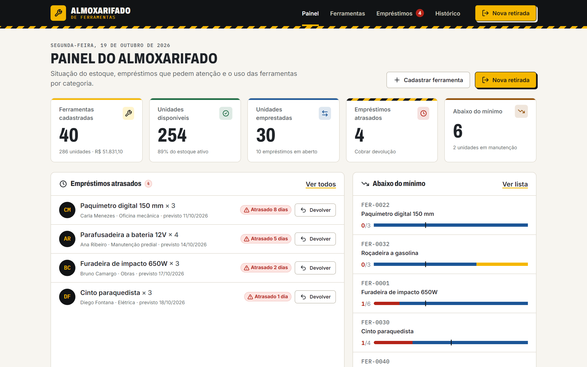
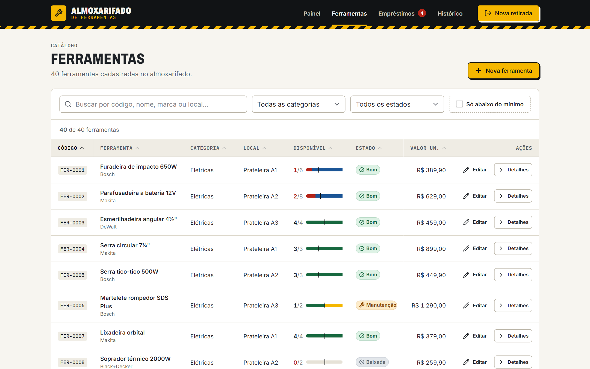
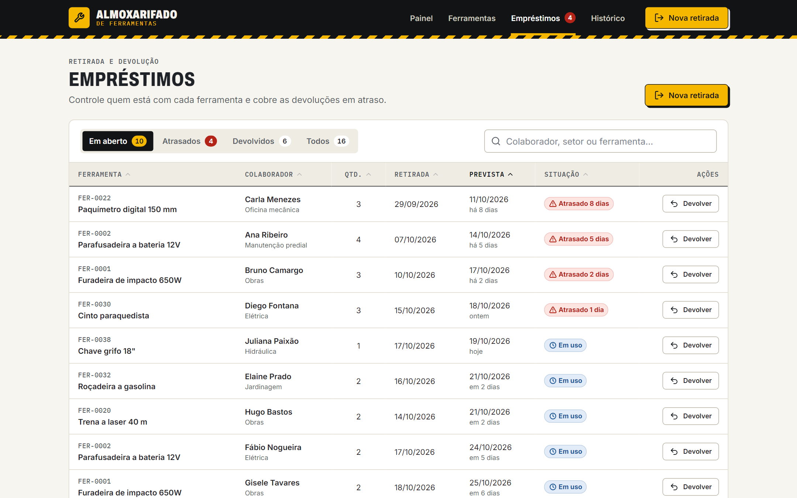
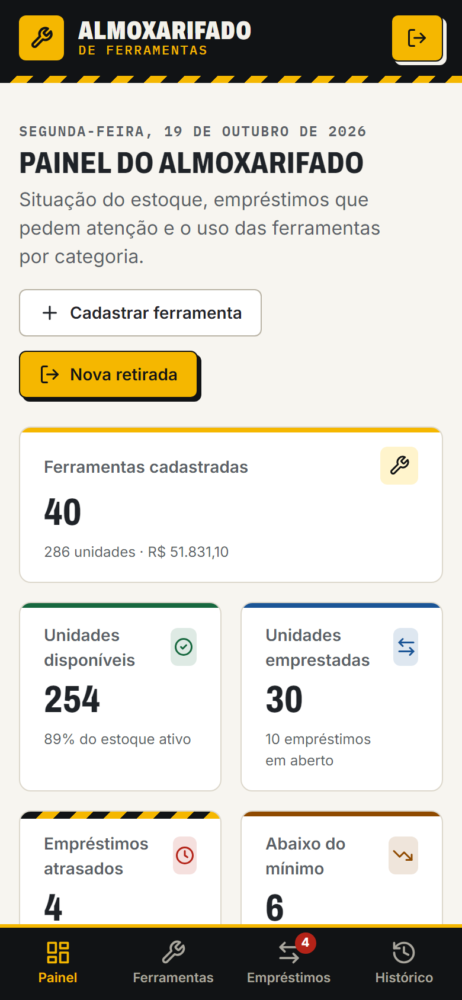

# Almoxarifado de Ferramentas

Aplicação web para **cadastro e controle de ferramentas com estoque**: catálogo com busca, filtros e ordenação; retirada e devolução por colaborador com bloqueio de estoque insuficiente; devolução com defeito enviando a unidade para manutenção; painel com indicadores, atrasos e uso por categoria; e um histórico completo de movimentações. Projeto de portfólio construído com **Vue 3 (Composition API) + TypeScript + Pinia + Vue Router**, com CSS escrito à mão (sem UI kit). Todos os dados são **fictícios** e ficam salvos apenas no `localStorage` do navegador.

**Demo ao vivo:** https://ppena23.github.io/controle-ferramentas-vue/



| Catálogo | Empréstimos | Celular |
|---|---|---|
|  |  |  |

---

## Funcionalidades

- **Painel** — 5 indicadores (ferramentas cadastradas, unidades disponíveis, emprestadas, empréstimos atrasados, abaixo do mínimo) com animação de contagem; lista de atrasados com atalho para devolução; ferramentas abaixo do estoque mínimo; gráfico de barras de uso por categoria feito só com CSS; últimas movimentações.
- **Catálogo de ferramentas** — busca com *debounce*, filtros por categoria, estado e "só abaixo do mínimo" (sincronizados com a URL), ordenação por coluna, barra visual de estoque (disponível / emprestada / manutenção / mínimo). No celular a tabela vira lista de cartões.
- **Cadastro e edição** com validação: campos obrigatórios, números ≥ 0, código único no padrão `FER-0000`, mensagens inline após o *blur*, botão de salvar desabilitado enquanto houver pendências, pré-visualização ao vivo e campo condicional de unidades em manutenção.
- **Proteção contra perda de dados** — sair do formulário com alterações abre um diálogo de confirmação (guard do Vue Router) e fechar a aba dispara o aviso nativo do navegador.
- **Empréstimos** — retirada de N unidades por colaborador com data prevista de devolução; a retirada é **bloqueada se a quantidade for maior que o disponível**. Devolução com observação opcional; marcando "devolvida com defeito", 1 unidade vai para manutenção. Abas Em aberto / Atrasados / Devolvidos / Todos com navegação por setas.
- **Detalhe da ferramenta** — ficha, composição do estoque, com quem estão as unidades, movimentações, concluir manutenção e exclusão (bloqueada se houver unidades emprestadas).
- **Histórico** — linha do tempo agrupada por dia, filtros por tipo de movimentação, período e busca, paginação "carregar mais".
- **Estados de UX** — *skeletons* durante o carregamento, estados vazios, estado de erro com "Tentar novamente" e *toasts* de sucesso/erro.
- **Controles da demonstração** (rodapé) — *Restaurar dados de exemplo* e *Simular falha de rede* (para ver o estado de erro).

**Regra de estoque:** `disponível = total − emprestadas − em manutenção` (ferramentas baixadas têm disponível 0).

## Conceitos de Vue 3 aplicados → onde no código

| Conceito | Onde |
| --- | --- |
| **Composition API / `<script setup lang="ts">`** | Todos os componentes e views em `src/components/` e `src/views/` |
| **`ref` / `reactive`** | `ref` nas stores (`src/stores/*.ts`); `reactive` nos formulários (`FerramentaForm.vue`, `EmprestimoForm.vue`) e nos filtros (`composables/useFilters.ts`) |
| **Props tipadas + `withDefaults`** | `components/base/BaseButton.vue`, `StatCard.vue`, `EstoqueBarra.vue` |
| **Emits tipados / `v-model` em componente** | `BaseInput.vue` e `BaseSelect.vue` (`update:modelValue`), `DataTable.vue` (`v-model:ordenacao`), `FerramentaForm.vue` (`enviar`, `cancelar`, `sujo`) |
| **Componente genérico (`generic="T"`) + slots com escopo** | `components/base/DataTable.vue` — slots `#celula-<coluna>` recebem a linha já tipada |
| **`computed`** | Getters das stores (`stores/estoque.ts`: disponível, abaixo do mínimo, totais), filtros e agrupamentos nas views, resumo ao vivo do formulário |
| **`computed` com getter/setter** | `stores/preferencias.ts` (ordenação persistida usada com `v-model`) |
| **`watch`** | `useFilters.ts` (filtros ⇄ URL), `useLocalStorage.ts` (persistência), `useDebounce.ts`, `BaseModal.vue` (foco e rolagem), `StatCard.vue` (animação de contagem), `FerramentaForm.vue` (campo condicional), `EmprestimosView.vue` (query `?nova=1` / `?devolver=id`) |
| **Composables** | `src/composables/`: `useToast`, `useFilters`, `useFormValidation`, `useDebounce`, `useLocalStorage`, `useUnsavedChangesGuard`, `useDados` |
| **Pinia (setup stores)** | `stores/ferramentas.ts`, `stores/emprestimos.ts`, `stores/historico.ts`, `stores/preferencias.ts` e a store derivada `stores/estoque.ts` (cruza catálogo × empréstimos) |
| **Vue Router** | `src/router/index.ts`: rotas `/`, `/ferramentas`, `/ferramentas/nova`, `/ferramentas/:id`, `/ferramentas/:id/editar`, `/emprestimos`, `/historico` e 404; *lazy loading*; `props: true`; `RouteMeta` tipado; `afterEach` para o título; `scrollBehavior`; hash history (GitHub Pages) |
| **Guard de rota (alterações não salvas)** | `composables/useUnsavedChangesGuard.ts` (`onBeforeRouteLeave` + diálogo próprio) usado em `views/FerramentaFormView.vue` |
| **async/await + Promises** | `services/api.ts` (API simulada com atraso e erros), *actions* das stores, handlers das views com `try/catch` |
| **Formulários e validação** | `composables/useFormValidation.ts` (regras declarativas, inclusive cruzadas e condicionais) |
| **Transições e animações** | Troca de rotas (`App.vue`), `BaseModal`, toasts e listas com `TransitionGroup`, skeleton, gráfico |
| **Teleport** | `BaseModal.vue` renderiza no `<body>` |
| **Acessibilidade** | Link "pular para o conteúdo", `aria-live` nos toasts, modal com *focus trap* + Esc + retorno de foco, `aria-sort` na tabela, abas com `role="tab"`, status sempre com texto + ícone (não só cor), `prefers-reduced-motion` |

## CSS

Sem framework de UI: tokens em CSS variables (`src/styles/main.css`), layout com **Grid** (`auto-fit`, `grid-template-areas`) e **Flexbox**, abordagem *mobile-first* com media queries, `clamp()` na tipografia, `:has()`, `color-mix()`, animações e transições. Identidade visual "oficina / segurança do trabalho": fundo off-white, grafite, amarelo de sinalização com acentos pretos e faixa zebrada usada com moderação. Fontes: Archivo (títulos condensados), Inter (texto) e IBM Plex Mono (códigos).

## Stack

- [Vue 3](https://vuejs.org/) + [TypeScript](https://www.typescriptlang.org/)
- [Pinia](https://pinia.vuejs.org/) — gerenciamento de estado
- [Vue Router 4](https://router.vuejs.org/) — rotas
- [Vite](https://vite.dev/) — build e servidor de desenvolvimento
- `vue-tsc` — checagem de tipos no build
- GitHub Pages — deploy (branch `gh-pages`)

## Como rodar

Pré-requisito: Node.js 20+.

```bash
npm install
npm run dev        # servidor de desenvolvimento
npm run build      # checagem de tipos (vue-tsc) + build de produção em dist/
npm run preview    # serve o build localmente
```

O site publicado no GitHub Pages é o conteúdo de `dist/` (gerado por `npm run build`) na branch `gh-pages`.

## Estrutura de pastas

```
src/
├── App.vue                  # layout: cabeçalho, RouterView com transição, rodapé, toasts
├── main.ts
├── router/index.ts          # rotas, meta, scrollBehavior, título da aba
├── types/index.ts           # tipos de domínio e de UI
├── services/api.ts          # API simulada (Promises + atraso + regras de negócio + localStorage)
├── data/seed.ts             # ~40 ferramentas e ~15 empréstimos fictícios, relativos à data de hoje
├── stores/                  # Pinia: ferramentas, emprestimos, historico, estoque (derivada), preferencias
├── composables/             # useToast, useFilters, useFormValidation, useDebounce, useLocalStorage…
├── utils/                   # datas, formatadores, regras de estoque e metadados de status
├── styles/main.css          # tokens, reset, utilitários e transições globais
├── components/
│   ├── base/                # BaseButton, BaseInput, BaseSelect, BaseModal, ConfirmDialog, DataTable,
│   │                        # StatCard, EmptyState, ErrorState, Badge, SkeletonBlock, ToastContainer, AppIcon
│   ├── layout/              # AppHeader, AppFooter, PageHeader
│   ├── ferramentas/         # FerramentaForm, EstadoBadge, EstoqueBarra
│   ├── emprestimos/         # EmprestimoForm, DevolucaoForm, StatusEmprestimoBadge
│   └── painel/              # UsoPorCategoriaChart
└── views/                   # Painel, Ferramentas, FerramentaForm, FerramentaDetalhe, Empréstimos, Histórico, 404
```

## Sobre os dados

Nomes de colaboradores, valores, quantidades e movimentações são **fictícios** e gerados em `src/data/seed.ts`. As marcas aparecem apenas como exemplo de catálogo. Os dados ficam no `localStorage` do seu navegador e podem ser restaurados a qualquer momento pelo botão **Restaurar dados de exemplo**, no rodapé.

---

Feito por **Pedro Pena** · [LinkedIn](https://www.linkedin.com/in/pedropena23/) · [GitHub](https://github.com/PPena23)
